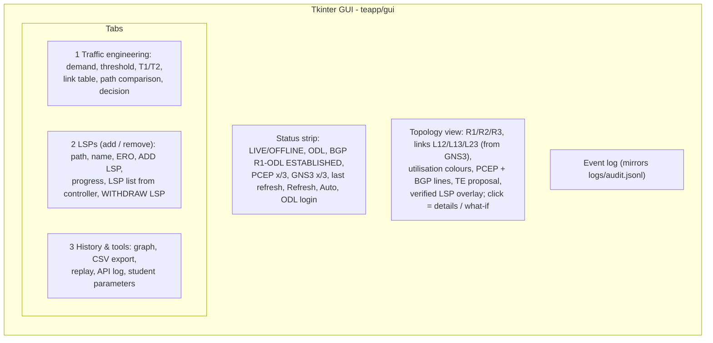
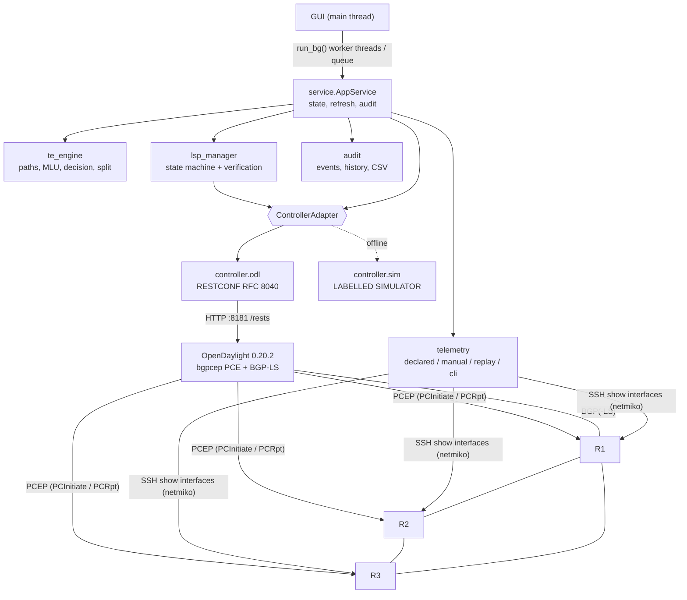

# Architecture (evidence F1)

## Frontend (operator GUI)



## Backend



## LSP provisioning and verification sequence

```mermaid
sequenceDiagram
  participant Op as Operator
  participant G as GUI
  participant M as LspManager
  participant O as OpenDaylight
  participant R as R1 (PCC)
  Op->>G: choose path + name, Provision
  G->>M: provision(name, [R1,R2,R3])
  M->>M: validate (name, links up, PCC session, no duplicate)
  M->>O: POST add-lsp (strict ERO)
  O->>R: PCInitiate
  O-->>M: 200 output{} -> ACCEPTED (not success)
  R-->>O: PCRpt (LSP state, RRO)
  loop every verify_poll_s until verify_timeout_s
    M->>O: GET pcep-topology LSP-DB
  end
  M-->>G: REPORTED -> OPERATIONAL (operational=up, path from RRO compared to intent)
  G-->>Op: overlay drawn from controller RRO; operator cross-checks with Postman + CLI
```

## Modules and responsibilities

| Module | Responsibility | Rubric link |
|---|---|---|
| `gui/app.py` | Windows, panels, input validation, feedback; no network calls on the UI thread | Core GUI |
| `gui/topology_view.py` | Topology, status, utilisation colours, verified LSP overlay | Core GUI, LSP visualisation |
| `service.py` | Single application state, refresh cycle, audit | Architecture |
| `te_engine.py` | Congestion model and path comparison | TE model |
| `lsp_manager.py` | Intended/requested/accepted/reported/operational; withdraw_requested/withdrawn | LSP add and withdraw (remove) |
| `controller/odl.py` | Real RESTCONF adapter, error classification | Architecture (adapter), Reliability |
| `controller/sim.py` | Clearly labelled offline mode | Reliability (honest state) |
| `telemetry.py` | Load sources with provenance | Status/provenance |
